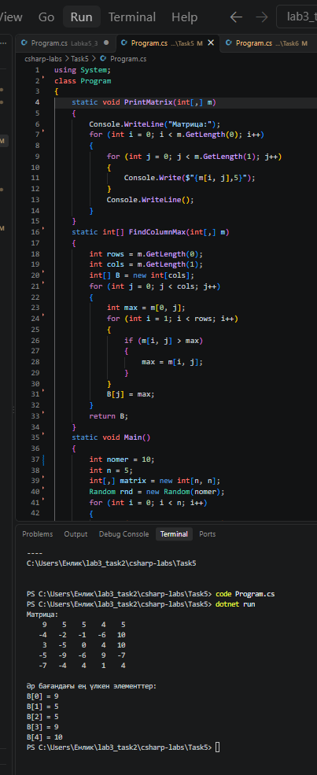
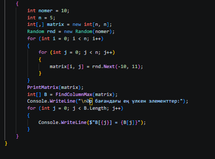

# 5-тапсырма: Екі өлшемді массивтер (3-нұсқа)

## Бағдарламаның мақсаты

5x5 өлшемді матрица құру, оны кездейсоқ сандармен толтыру және әр бағандағы ең үлкен элементтерден B массивін құру.

## Бағдарламаны іске қосу

```bash
dotnet run
```

## Тест нәтижелері

| № | Тест мәліметтері | Қолмен есептелген жауап | Бағдарлама жауабы |
|---|---|---|---|
| 1 | Random(10) | 9, 5, 5, 9, 10 | 9, 5, 5, 9, 10 |
| 2 | 1, 2, 3, 4, 5; 6, 7, 8, 9, 0; -1, -2, -3, -4, -5; 10, 0, 1, 2, 3; 4, 5, 6, 7, 8 | 10, 7, 8, 9, 8 | 10, 7, 8, 9, 8 |
| 3 | -9, -8, -7, -6, -5; -4, -3, -2, -1, -10; -6, -5, -4, -3, -2; -8, -9, -10, -7, -6; -1, -2, -3, -4, -8 | -1, -2, -2, -1, -2 | -1, -2, -2, -1, -2 |
| 4 | 5, 0, -2, 3, 1; 2, 8, 4, -1, 0; -3, 6, 7, 2, -4; 1, -2, 0, 9, 5; 4, 3, -1, 6, 2 | 5, 8, 7, 9, 5 | 5, 8, 7, 9, 5 |

## Скриншоттар

**Бағдарлама коды:**



**Үш тесттің орындалу нәтижелері:**



## Сұрақтарға жауап

**1. Екі өлшемді массивте matrix[i,j] жазбасы нені білдіреді?**

`i` индексі матрицаның жолын, ал `j` индексі бағанын білдіреді. `GetLength(0)` жол санын, `GetLength(1)` баған санын қайтарады. Осы әдістер арқылы массив өлшемдерін анықтауға болады.

**2. Неліктен сыртқы цикл бағандар бойынша, ал ішкі цикл жолдар бойынша орындалады?**

Сыртқы цикл әр бағанды кезекпен таңдайды, ал ішкі цикл сол бағандағы барлық жолдарды тексереді. Осылайша әр бағанның ең үлкен элементін жеке табуға мүмкіндік береді.

**3. Неліктен ішкі цикл i = 1 мәнінен басталады және неше рет орындалады?**

Алғашқы максимум ретінде `m[0,j]` элементі алынады, сондықтан оны қайта тексерудің қажеті жоқ. Ішкі цикл 1-ден 4-ке дейін орындалады, яғни әр баған үшін 4 рет, ал барлық баған бойынша 20 рет орындалады.